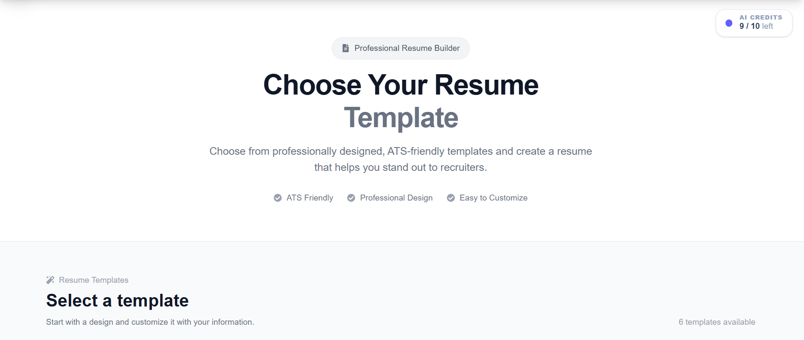
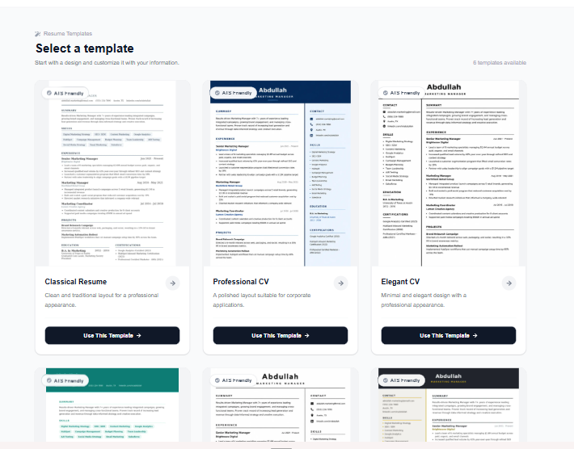
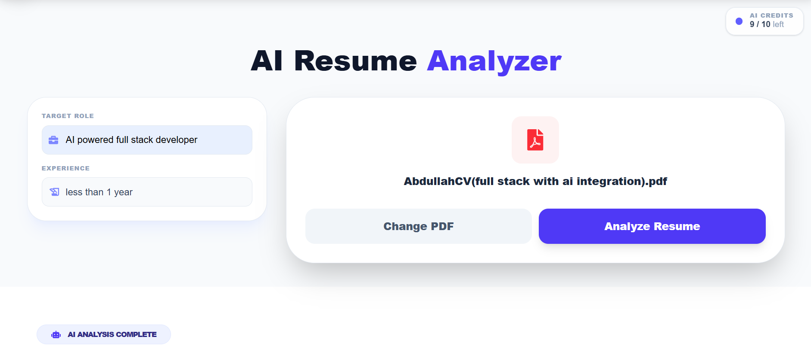
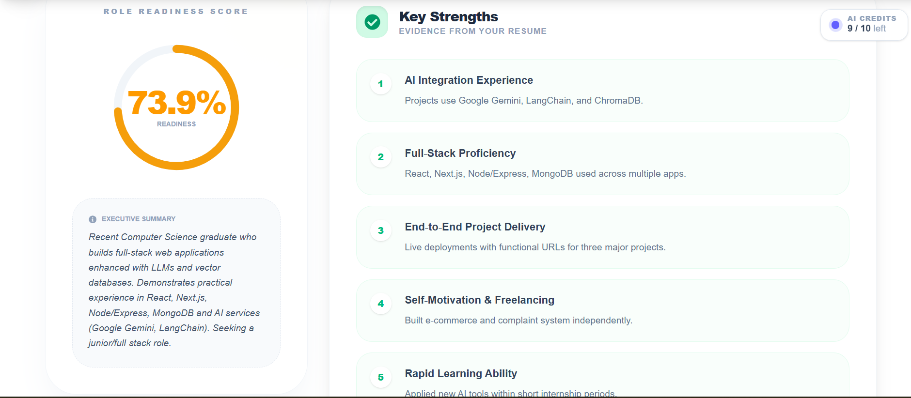
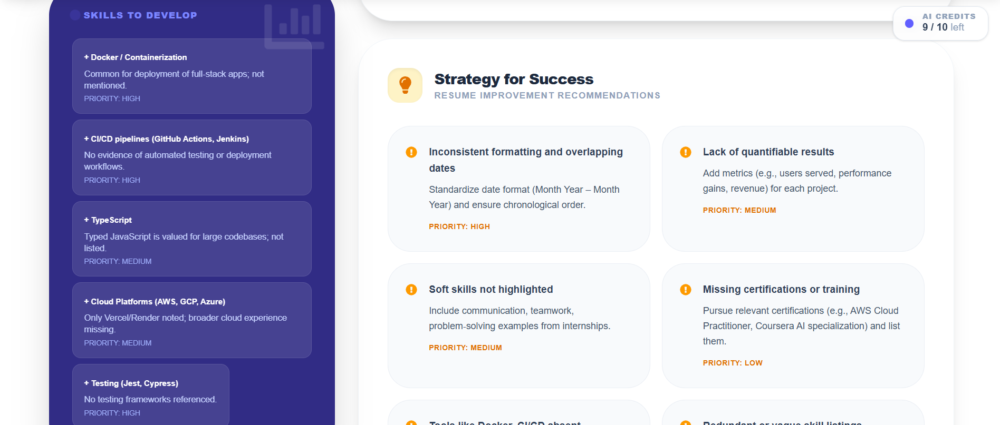
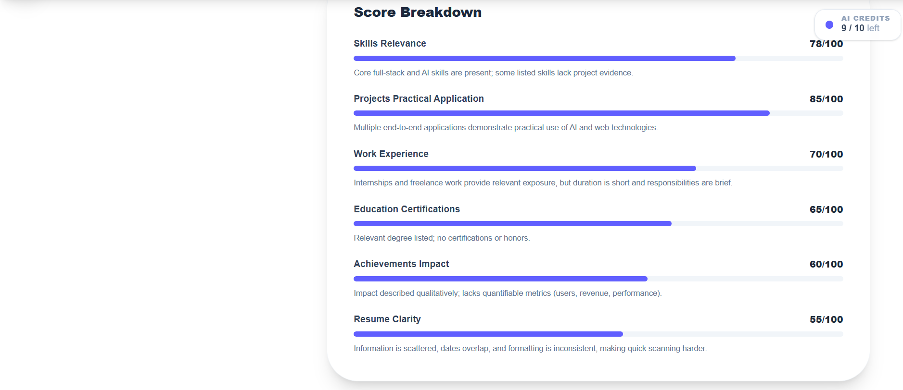
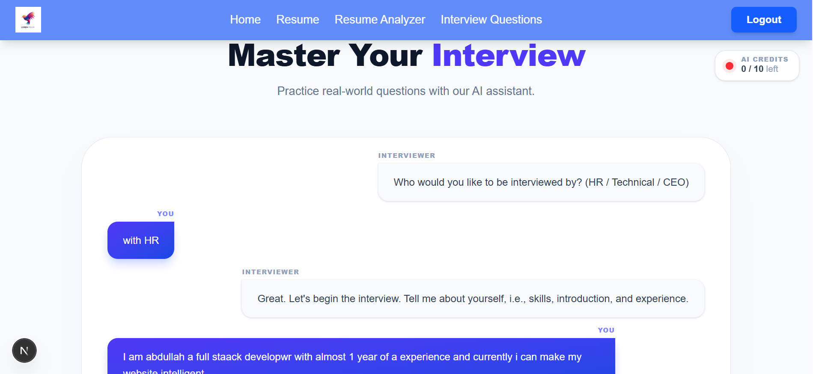

# AI Career Assistant

AI Career Assistant helps job seekers build resumes, understand how their experience fits a target role, and practice interviews. It combines a resume builder with live previews and PDF downloads, AI-powered resume analysis, and a conversational mock interviewer. Administrator dashboards track user activity, feature adoption, and API usage.

The application has a Next.js frontend and a separate Express API backed by MongoDB. Groq powers analysis and interviews through LangChain; Firebase and Google Analytics support notifications and reporting.

> **Implementation status:** Resume building uses templates and user-entered data, without AI content generation. The analyzer calculates role readiness, rather than a job-description match or certified ATS score. Google authentication, push delivery, and scheduled reporting have known issues described below.

## Contents

- [Features](#features)
- [Technology stack](#technology-stack)
- [Architecture and structure](#architecture-and-structure)
- [Setup](#setup)
- [Environment variables](#environment-variables)
- [Scripts and validation](#scripts-and-validation)
- [API reference](#api-reference)
- [Data and authentication](#data-and-authentication)
- [Deployment](#deployment)
- [Known limitations](#known-limitations)
- [Screenshots](#screenshots)
- [Contributing](#contributing)
- [License and contact](#license-and-contact)

## Features

### Resume builder

- Six templates: Classical, Professional, Elegant, Optimized, Bold, and Modern.
- Contact details, professional summary, skills, projects, work experience, education, and certifications.
- Repeatable form sections with add/remove controls and input limits.
- Live previews as the form changes, plus template-specific PDF downloads using jsPDF.
- React Hook Form/Zod frontend validation and express-validator backend validation.

The backend submission validates form data and updates remaining credits. It does not invoke an LLM, rewrite content, save a resume document, or return generated resume content. Previews and PDF exports use the user's form data.

### AI resume analysis

The AI Resume Analyzer evaluates a resume against a selected target role and experience level. It extracts text from text-readable PDF files and generates structured feedback to help candidates identify strengths, missing skills, and areas for improvement.

## Input requirements and limitations

Upload a text-readable PDF of up to 3 MB and 5 pages.

Select a target role and experience level.

Image-only scanned PDFs are not supported because OCR is not implemented.

Analysis is based on the extracted resume text and the selected role and experience level; no job description is required.

## Analysis results

The analyzer returns:

- Candidate overview and executive summary.

- Skills and supporting resume evidence.

- Project, work experience, education, certification, and achievement information where available.

- Category scores and an overall role-readiness score.

- Key strengths and missing or underrepresented skills.

- Prioritized improvement recommendations.

- Resume formatting, clarity, and consistency issues.

- Analysis limitations where information is missing or cannot be verified.

- The backend validates model responses, rejects empty or truncated output, checks JSON structure, and verifies that required category scores are present and within the permitted range.

## Role-readiness score

The backend computes a weighted **role-readiness score out of 100** from model-produced category scores:

| Category                           | Weight |
| ---------------------------------- | ------ |
| Skills relevance                   | 30%    |
| Projects and practical application | 25%    |
| Work experience                    | 20%    |
| Education and certifications       | 10%    |
| Achievements and impact            | 10%    |
| Resume clarity                     | 5%     |

No job description is supplied. The score evaluates resume evidence for a general role and experience level; it does not guarantee hiring outcomes or compatibility with a specific ATS.

### Mock interviews

- Text conversations with an AI interviewer.
- The prompt asks for the user's profession, interview type (**HR**, **Technical**, or **CEO**), and introduction before asking relevant questions.
- Instructions ask the model to give brief feedback, ask one question at a time, and repeat questions when answers are off-topic.
- LangChain stores separate in-memory histories keyed by authenticated user ID, trimming earlier context to the most recent 10 messages when history is retrieved.

Interview behavior depends on model compliance. History is not saved to MongoDB and disappears when the backend restarts.

### Accounts, Credits, and Notifications

- Local signup, password-based login, logout, and cookie-based session checks.

- User, Admin, and SuperAdmin roles.

- A daily allowance of 10 API requests, shared across supported AI features, with a remaining-credit indicator.

- Low-credit notifications when three or fewer requests remain.

- Signup welcome notifications and administrator notifications for new users.

- In-app notification inboxes, pagination, unread counts, and marking notifications as read.

- Personal seven-day and 30-day usage reports.

- Browser notification registration and Firebase push-notification services; end-to-end delivery must be verified in the deployed environment.

### Personal Weekly and Monthly Analytics

Personal analytics provide a view of credit usage and AI feature activity over a selected reporting period.

Reported metrics may include:

- Credits allocated and consumed during the reporting period.

- Unused credit balance, where it can be reconciled accurately.

- Usage by feature, including Resume Builder, ATS Analyzer, and Mock Interview.

- Usage trends over time.

- Successful and failed API requests.

- Success and failure rates.

### Administrator dashboards

The `/AdminDashboard` area offers weekly (`7d`), monthly (`30d`), and yearly (`1y`) reporting:

- **Users:** totals, active/inactive/new users, growth, device breakdown, countries, and retention indicators.
- **Features:** totals, comparisons, percentages, and usage over time.
- **AI/API usage:** total calls, calls by feature, trends, success ratio, and average usage.
- **Notifications:** administrator inbox.

User activity and device metrics use MongoDB; country, feature, API-call, and personal usage reporting use the Google Analytics Data API. Retention is an activity-based indicator rather than cohort analysis. There is no user-management CRUD interface or separate SuperAdmin management workflow.

## Technology stack

Versions describe package manifests, not a claim that every dependency has been runtime-tested.

| Area                    | Verified technologies                                                                                        |
| ----------------------- | ------------------------------------------------------------------------------------------------------------ |
| Language/runtime        | JavaScript/JSX; Node.js **22.x** declared by the backend                                                     |
| Frontend                | Next.js **16.1.6** App Router, React **19.2.3**, React Compiler enabled                                      |
| UI/styling              | Tailwind CSS **4**, React Icons, React Hot Toast                                                             |
| State/HTTP              | Redux Toolkit, React Redux, async thunks, Axios                                                              |
| Forms                   | React Hook Form, Zod, Hook Form resolvers                                                                    |
| Charts/PDF              | Recharts, jsPDF                                                                                              |
| Backend                 | Express **5**, CommonJS, dotenv, CORS, cookie-parser                                                         |
| Database                | MongoDB with Mongoose **9**                                                                                  |
| Authentication          | bcrypt, JSON Web Tokens, browser Google OAuth integration                                                    |
| AI                      | Groq through `@langchain/groq`, LangChain Core/Community; configured model `openai/gpt-oss-120b`             |
| PDF input               | Multer memory storage, `pdf-parse`                                                                           |
| Reporting/notifications | Firebase browser/Admin SDKs, FCM integration, GA4 Measurement Protocol, Google Analytics Data API, node-cron |
| Development             | npm lockfiles, nodemon, ESLint **9**, Next.js ESLint rules, PostCSS                                          |

## Architecture and structure

The browser renders Next.js pages and dispatches Redux thunks that call Express through Axios with credentials enabled. Express verifies session cookies and checks credits before career-tool controllers run. Controllers use MongoDB models, Groq/LangChain services, or analytics services as needed.

Resume preview/PDF export runs in the browser. Uploaded PDFs are parsed on the backend, and extracted resume text is sent to Groq. Interview messages also reach Groq. Browser Firebase events and backend GA4 events feed analytics reports. Cron jobs inside the API process create report notifications and attempt push delivery.

```text
AI-Career-Assistant/
|-- Backend/
|   |-- Server.js             # API mounts, database and cron startup
|   |-- Config/               # MongoDB, Groq, Firebase Admin, Multer
|   |-- Controller/           # Auth, tools, analytics, notifications
|   |-- MiddleWare/           # JWT, admin roles, ownership, credits
|   |-- Model/                # Users, usage, notifications, FCM registrations
|   |-- Prompts/              # Analyzer and interviewer instructions
|   |-- Routes/               # Express routers
|   |-- Services/             # AI, PDF parsing, analytics, push
|   |-- Utilis/               # Credits, GA4 events, notifications, cron
|   |-- Validator/            # Resume request validation
|   `-- package.json
|-- Frontend/
|   |-- app/
|   |   |-- (userDashboard)/  # Home, signup, tools, inbox, personal reports
|   |   |-- AdminDashboard/   # Analytics and administrator inbox
|   |   |-- StoreProvider.js  # Redux and notification registration
|   |   `-- CheckLogin.jsx   # Session check and admin redirect
|   |-- Component/            # Forms, navigation, charts, templates, loaders
|   |-- Features/             # Analysis results, resume display, credits
|   |-- Libraries/            # Store/slices/thunks, Firebase, Zod schema
|   |-- public/               # Images and messaging service worker
|   `-- package.json
|-- ScreenShot/               # Existing screenshots
`-- README.md
```

Spellings such as `MiddleWare`, `Utilis`, and `Libraries/Thuncks` match the source. There is no root npm workspace or combined startup script.

## Setup

### Prerequisites

- Node.js **22.x** and npm.
- MongoDB, locally or through a connection URI.
- A Groq key with access to the configured model for AI features.
- Firebase project, web app configuration, and Firebase Admin service-account JSON. Admin initialization runs during backend startup, even for local authentication.
- Google Analytics service-account credentials and a GA4 property. Reporting clients load during backend startup, so their configuration cannot simply be omitted.
- A Google OAuth web client for Google account buttons.
- GA4 property access and definitions matching `customEvent:feature`, `customEvent:status`, and `customUser:app_user_id` used by reporting queries.
- For browser push: permission, a supported secure browser context, and a Firebase web-push VAPID public key.

### Install

```bash
git clone https://github.com/smabdullah958/AI-Career-Assistant.git
cd AI-Career-Assistant
cd Backend
npm ci
cd ../Frontend
npm ci
cd ..
```

Both applications include npm lockfiles. `Backend/.npmrc` sets `legacy-peer-deps=true`; retain this setting for backend installs. The backend `build` script only installs dependencies.

### Configure

Create `Backend/.env` and `Frontend/.env.local` using the variables below. No environment example files are supplied. Names are case-sensitive, including `PortNo`, `connection`, `Frontend`, and `PropertyID`.

Set `Frontend` to the frontend origin and `NEXT_PUBLIC_BackendURL` to the API base URL. Examples use ports 3000 and 5000; the API has no fallback port.

Use your own Firebase web configuration and authorize the frontend origin for your Google OAuth web client. The messaging service worker contains a fixed Firebase configuration: environment variables alone do not switch that worker to another project.

### Start

Make MongoDB available, then run the backend in one terminal:

```bash
cd Backend
npm run dev
```

Run the frontend in a second terminal:

```bash
cd Frontend
npm run dev
```

Open `http://localhost:3000`. The example API base URL is `http://localhost:5000`; no root API page or health endpoint is implemented.

Cookies always use `httpOnly: true`, `secure: true`, and `sameSite: "none"`. Local HTTP behavior depends on browser localhost handling; use HTTPS for reliable cookie testing. There is no environment switch for cookie options or built-in HTTPS configuration.

## Environment variables

Never put backend credentials in `NEXT_PUBLIC_*` variables, which are exposed to the browser. All values below are placeholders.

### Backend: `Backend/.env`

```dotenv
PortNo=5000
connection=Your_Mongodb_connection
SecretKey=REPLACE_WITH_A_LONG_RANDOM_SECRET
Frontend=http://localhost:3000
Groq_API=YOUR_GROQ_API_KEY
FIREBASE_SERVICE_ACCOUNT=YOUR_COMPLETE_SERVICE_ACCOUNT_JSON_ON_ONE_LINE
GOOGLE_CLIENT_EMAIL=YOUR_ANALYTICS_SERVICE_ACCOUNT_EMAIL
GOOGLE_PRIVATE_KEY="YOUR_ANALYTICS_PRIVATE_KEY_WITH_ESCAPED_NEWLINES"
PropertyID=YOUR_NUMERIC_GA4_PROPERTY_ID
GA4_MEASUREMENT_ID=YOUR_GA4_MEASUREMENT_ID
GA4_API_SECRET=YOUR_MEASUREMENT_PROTOCOL_SECRET
Client_ID=YOUR_GA4_CLIENT_ID
```

| Variable                   | Purpose and requirement                                                                                                    |
| -------------------------- | -------------------------------------------------------------------------------------------------------------------------- |
| `PortNo`                   | Required API listening port.                                                                                               |
| `connection`               | Required MongoDB URI.                                                                                                      |
| `SecretKey`                | Required JWT signing/verification secret.                                                                                  |
| `Frontend`                 | Required allowed CORS origin; also builds report URLs.                                                                     |
| `Groq_API`                 | Required for analyzer and interview model calls.                                                                           |
| `FIREBASE_SERVICE_ACCOUNT` | Required at startup; replace the placeholder with the complete JSON credential object on one line, parsed by `JSON.parse`. |
| `GOOGLE_CLIENT_EMAIL`      | Analytics service-account email; reporting clients load at startup.                                                        |
| `GOOGLE_PRIVATE_KEY`       | Analytics private key; literal `\n` sequences are converted into newlines during module loading.                           |
| `PropertyID`               | Numeric property ID used in Data API `properties/<id>` requests.                                                           |
| `GA4_MEASUREMENT_ID`       | Backend GA4 event destination.                                                                                             |
| `GA4_API_SECRET`           | Measurement Protocol event-submission secret.                                                                              |
| `Client_ID`                | Client ID passed to backend GA4 helpers; distinct from the frontend OAuth client ID.                                       |

GA4 submission failures are logged and swallowed, but missing or invalid reporting configuration can prevent startup or reports. Analytics is integrated into feature flows rather than exposed as an optional module.

### Frontend: `Frontend/.env`

```dotenv
NEXT_PUBLIC_BackendURL=http://localhost:PortNo_of_backend
NEXT_PUBLIC_GOOGLE_CLIENT_ID=YOUR_GOOGLE_OAUTH_WEB_CLIENT_ID
NEXT_PUBLIC_FIREBASE_API_KEY=YOUR_FIREBASE_WEB_API_KEY
NEXT_PUBLIC_FIREBASE_AUTH_DOMAIN=YOUR_FIREBASE_AUTH_DOMAIN
NEXT_PUBLIC_FIREBASE_PROJECT_ID=YOUR_FIREBASE_PROJECT_ID
NEXT_PUBLIC_FIREBASE_STORAGE_BUCKET=YOUR_FIREBASE_STORAGE_BUCKET
NEXT_PUBLIC_FIREBASE_MESSAGING_SENDER_ID=YOUR_FIREBASE_MESSAGING_SENDER_ID
NEXT_PUBLIC_FIREBASE_APP_ID=YOUR_FIREBASE_WEB_APP_ID
NEXT_PUBLIC_FIREBASE_MEASUREMENT_ID=YOUR_FIREBASE_MEASUREMENT_ID
NEXT_PUBLIC_VAPID=YOUR_FIREBASE_WEB_PUSH_PUBLIC_KEY
```

| Variable(s)                                                                                                                                                                                                             | Purpose and requirement                                                                   |
| ----------------------------------------------------------------------------------------------------------------------------------------------------------------------------------------------------------------------- | ----------------------------------------------------------------------------------------- |
| `NEXT_PUBLIC_BackendURL`                                                                                                                                                                                                | Required API base URL without a trailing slash.                                           |
| `NEXT_PUBLIC_GOOGLE_CLIENT_ID`                                                                                                                                                                                          | Root OAuth provider and Google account buttons.                                           |
| `NEXT_PUBLIC_FIREBASE_API_KEY`, `NEXT_PUBLIC_FIREBASE_AUTH_DOMAIN`, `NEXT_PUBLIC_FIREBASE_PROJECT_ID`, `NEXT_PUBLIC_FIREBASE_STORAGE_BUCKET`, `NEXT_PUBLIC_FIREBASE_MESSAGING_SENDER_ID`, `NEXT_PUBLIC_FIREBASE_APP_ID` | Firebase web-app initialization, imported across account, analytics, and messaging flows. |
| `NEXT_PUBLIC_FIREBASE_MEASUREMENT_ID`                                                                                                                                                                                   | Firebase/GA4 browser analytics.                                                           |
| `NEXT_PUBLIC_VAPID`                                                                                                                                                                                                     | Web-push public key when enabling browser notifications.                                  |

Restart development servers after environment changes. Supply public frontend variables when building production output.

## Scripts and validation

Run each command from its application directory:

| Directory  | Command         | Behavior                                                        |
| ---------- | --------------- | --------------------------------------------------------------- |
| `Backend`  | `npm run dev`   | Express through nodemon.                                        |
| `Backend`  | `npm start`     | `node Server.js`.                                               |
| `Backend`  | `npm run build` | Runs `npm install`; no compilation.                             |
| `Backend`  | `npm test`      | Placeholder that exits with failure; no test suite.             |
| `Frontend` | `npm run dev`   | `next dev --webpack`.                                           |
| `Frontend` | `npm run lint`  | ESLint, Next.js Core Web Vitals rules, and `no-console` errors. |
| `Frontend` | `npm run build` | Next.js production build.                                       |
| `Frontend` | `npm start`     | Serves the successful production build.                         |

No automated application tests or CI/deployment workflows were found in tracked files. Lint/build success does not verify MongoDB, AI, OAuth, analytics, cookies, or push delivery. Check those separately using configured services. Starting the API also starts its cron jobs at the frequencies documented below.

During the README audit, `npm run lint` reported **65 errors and 8 warnings** in existing frontend code, including hook/component naming, state updates in effects, and unescaped JSX text. A production build and live service integration tests were not run as part of this documentation change.

## API reference

These are the exact mounted paths, including existing spelling errors. Protected requests authenticate through the **`token` cookie**, not a bearer header. Browser clients must include credentials.

There are no saved-resume, analysis-history, or interview-transcript models. Resume form/results live in component/Redux state. Uploaded PDFs use memory storage; extracted text and interview messages are sent to Groq.

Local signup hashes passwords with bcrypt. Signup/login issue a one-week JWT containing user ID, email, and role in the `token` cookie. Axios uses `withCredentials: true`; Express allows credentials from the configured frontend origin.

Frontend session checks redirect administrators to their dashboard. Backend middleware verifies JWTs, restricts reporting to administrator claims, and checks ownership for personal reports. The role-assignment and Google verification defects below must be addressed before relying on this access model publicly.

Credits are allocated when a date's usage record is missing. Daily middleware/session checks use `Asia/Karachi`, while signup/login allocation uses UTC. One credit is deducted before a tool controller runs; invalid or failed requests are not automatically refunded.

## Deployment

No provider-specific deployment manifest, container setup, or automated release workflow is included. Run two separate Node.js services:

1. Install backend dependencies in `Backend`, provide environment variables/MongoDB access, and run `npm start` under a persistent process manager or hosting service.
2. Install frontend dependencies in `Frontend`, provide public variables, run `npm run build`, then `npm start`.
3. Set `Frontend` to the exact frontend origin and `NEXT_PUBLIC_BackendURL` to the API URL. Use HTTPS and verify browser cross-origin cookies.
4. Configure Firebase, OAuth origins, GA4 access/custom definitions, and web-push settings for the deployment.
5. Address the known authentication and scheduling issues before public operation.

Every API process runs cron jobs, so multiple replicas can duplicate notifications. Interview histories are process-local and are neither shared between replicas nor retained across restarts.

## Screenshots

These existing repository assets illustrate captured UI states and may differ from current screens.

### Resume builder




### Resume analysis






### Interview practice



## Contributing

Review the relevant frontend-to-backend flow before changing a feature. Keep credentials out of commits, update documentation for setup/API changes, run frontend lint/build checks, and manually verify affected integrations. Describe behavior changes and validation in pull requests.

## License and contact

No repository-level `LICENSE` file is included. `Backend/package.json` declares `ISC`; the frontend is private and has no license declaration. A repository-wide license is therefore unspecified.

- [Author's portfolio](https://smabdullah.netlify.app/)
- [Author's GitHub](https://github.com/smabdullah958)
- [Repository](https://github.com/smabdullah958/AI-Career-Assistant)
